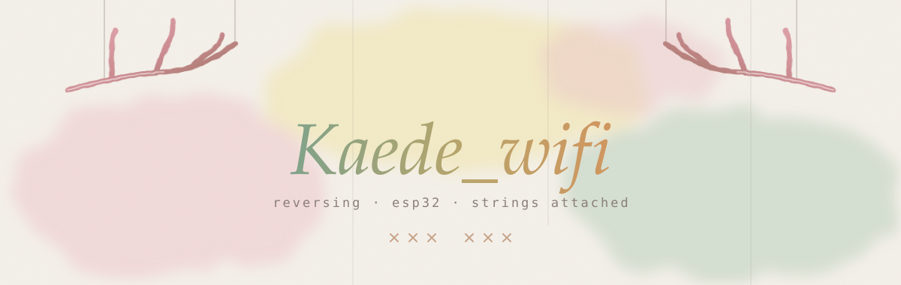

  

  <i>packed layers peel back 
  the vm unspools its strings 
  opcode by opcode</i>

  windows and linux reversing 
  vmprotect, themida and whatever else wraps a binary in layers 
  esp32 firmware reversing, flash dumps, xtensa and risc-v

  
  
  
  
  
  
  
  
  
  

  
  

